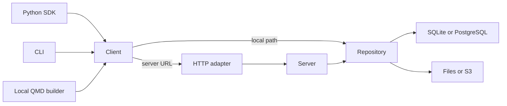

# Architecture

Cairn stores artifacts. Every artifact has one permanent ID and is writable until
finished, then immutable. Runs, reports, datasets, models and custom viewers use
that same lifecycle; namespaces and typed payload formats provide their meaning.

The server implements the same `RepositoryProtocol` as local storage. It validates
requests and routes them to the repository. Type-specific behavior belongs in
clients and viewers: environment capture in Python, report execution in the local
builder, media interpretation in codecs and UI components.

## Identity and naming

An artifact is a concrete recorded object, not a container of revisions. Starting
another object under the same project/namespace/name creates another artifact ID.
Finishing preserves that ID and assigns a numeric version label. `@latest`, `@v3`
and explicit aliases resolve directly to artifact IDs. Name rows hold only the
next label counter and latest pointer; they are not separately identified objects.

Full IDs are random hexadecimal values. Unambiguous prefixes of at least eight
characters are accepted. Exact IDs are independent of project scope; names are
project-scoped. There are no revision IDs, version IDs, or snapshot operations.

## Durable writes

A writer handle tracks one producer's contiguous sequence numbers. Each accepted
record also gets a shared artifact ordinal. Batch validation, dependency retention,
capacity accounting and acknowledgement commit in one SQL transaction. Exact
retries are idempotent; changed content at an existing sequence conflicts.

Finishing persists one intent and stops new producer admission. Existing producers
drain and close; the artifact then becomes immutable and receives its label. This
internal draining state does not create another artifact. Two independent objects
with the same name can finish concurrently; each receives its own label and the
last committed finish becomes latest. Explicit alias changes use compare-and-swap.

Local writes use SQLite WAL with synchronous FULL and verified filesystem blobs.
Remote deployments may use the same SQLite/files backend or PostgreSQL with files
or S3. The remote client journal is a delivery queue, not another queryable repo.
Reading never initializes or resumes it. Buffered writes persist before returning;
flush and finish wait for acknowledgement. Uncertain requests retain their exact
idempotency identity across recovery.

## Storage tables

- `artifacts`: identity, name, state, metadata, acknowledged cutoff, finish intent,
  final manifest, numeric label, capacity counter and timestamps.
- `annotations`: mutable properties and comments, each targeting an exact artifact
  or every version of a name. Each artifact stores its effective properties and
  their ETag as a projection, with a derived array-member lookup for indexed
  SQLite filtering and a PostgreSQL GIN annotation index.
- `names`, `aliases`: name-level counters and pointers to artifacts.
- `writers`, `records`: producer acknowledgements and append-only evidence.
- `blobs`, `blob_refs`, `artifact_refs`: immutable content and retained dependencies.
- `requests`: mutation retry receipts.
- `meta`: repository identity, schema and temporary maintenance leases.

Records remain in the same artifact when it finishes. Query cursors freeze an
acknowledged cutoff, including for live reads. Finished readers and dependencies
pin exact IDs. Retention protects every referenced blob and finished artifact,
including references in pending finalization intents.

## Provenance and reports

Run helpers capture config, Python/platform/process information, package inventory,
Git state, dirty source changes, a bounded source archive and dependency files.
Collection happens on the client through ordinary metadata and file captures.
Omissions are reported; raw environment variables are not dumped. Generic artifact
creation performs no automatic capture. See README for provenance opt-outs.

The QMD builder captures source/includes/resources, resolves declared finished
inputs, executes a fresh local kernel and packages outputs plus source mappings.
Its explicit pinned reader avoids global backend monkeypatches. A report is an
ordinary artifact containing the completed bundle. Editing and execution are local;
the server stores, queries and serves data only.

## Maintenance and boundaries

Transfer verifies bytes and imports metadata atomically, preserving IDs. Conflicts
never silently overwrite existing evidence. Imported producer handles close; a
live artifact can attach a new producer. Integrity checks independently reconstruct
metadata, captures, sequence accounting, manifests and retention. Soft deletion
hides named discovery; retained finished IDs remain readable until explicit purge.

Publication collections are bounded and checked during ingestion; large payloads
belong in blobs. Limits are advertised by `info()` and documented in CONTRACT.md.
The schema is 7, protocol 4 and client journal schema 3. Schema 6 repositories
convert only through the explicit `cairn repo migrate`; no implicit migration is
attempted, and older prototype stores are rejected.

`tools/count_python.py` counts all handwritten package Python, including comments
and blank lines. UI implementation is owned separately; this lifecycle refactor
changes backend contracts without changing the UI.

Artifact discovery and record queries share a predicate compiler. Discovery applies
it to artifact metadata and mutable annotations, combining it with array membership and lifecycle
filters before SQL pagination. The Python iterator, CLI and HTTP API share this
implementation; no client-side download-and-filter path is used.
